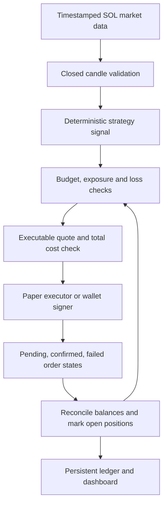

# Public bot research and proposed Solana blueprint

Reviewed October 6, 2026. This is a design comparison, not a measured performance
ranking. No reviewed primary source establishes which bot will earn the most for
this account. Public code and attractive backtests do not establish a live edge.

My recommendation for the discussed roughly $500 allocation is to evaluate
long-only SOL trading first, with fewer trades and explicit costs. This is a
recommendation about testability and operational complexity, not a prediction
that SOL or a particular strategy will be profitable. Pump.fun token speculation
is a separate market and strategy. SOL itself does not need Pump.fun token
discovery or its metered token-trade feed.

| Blueprint | Useful design | Suitability for this bot |
|---|---|---|
| Freqtrade | Separate indicators, entry, exit and order logic; historical backtests plus live dry runs | Strong model for the SOL strategy evaluation workflow; not a ready-made Pump.fun connector |
| Hummingbot V2 | Market-data provider, strategy controllers and finite order executors | Strong model for reliable position and order lifecycle management; market making is not automatically suitable for a $500 wallet |
| Jupiter Swap API | Quote/assemble, sign, submit and observe execution | Candidate for SOL/USDC execution on Solana; requires API access and a signing integration; it supplies execution, not a profitable strategy |
| PumpPortal | Free creation events; metered token trades; transaction APIs | Useful for Pump.fun discovery, but trading costs and token liquidity need their own model |

Sources: [Freqtrade strategy guide](https://www.freqtrade.io/en/stable/strategy-101/),
[Freqtrade public strategy repository](https://github.com/freqtrade/freqtrade-strategies),
[Hummingbot architecture](https://hummingbot.org/strategies/v2-strategies/),
[Jupiter Swap API](https://developers.jup.ag/docs/swap),
[PumpPortal fees](https://pumpportal.fun/fees/).

The Freqtrade guide warns that strategy-ranking backtests can be unrealistic and
provides lookahead and recursive analysis. Its public example strategies are
templates to understand and test, not a verified live-profit leaderboard. One
inspectable implementation is [Strategy004.py](https://github.com/freqtrade/freqtrade-strategies/blob/main/user_data/strategies/Strategy004.py).
For executor/controller separation, the public [Hummingbot controller base](https://github.com/hummingbot/hummingbot/blob/master/hummingbot/strategy_v2/controllers/controller_base.py)
provides the implementation behind the architectural pattern.

## Cost findings

PumpPortal documents a 0.5% Local transaction service fee or 1% Lightning service
fee on each trade, excluding Solana network and Pump.fun platform fees. For a
roughly unchanged $100 position, buying then selling costs approximately $1
Local or $2 Lightning in service fees alone. These are illustrations, not
quotes. Slippage, priority fees and the underlying venue fees add further costs.
Token-trade data adds 0.01 SOL per 10,000 received trades; creation and migration
events are free. [Provider fee schedule](https://pumpportal.fun/fees/).

The uploaded backtester assumes only 0.1% trading cost per side plus 0.05%
slippage. That does not represent the PumpPortal paths above. Under those paths,
small frequent mean-reversion gains can be consumed by costs. The exact outcome
requires executable quotes and actual fills. [Pump.fun's own fee schedule](https://pump.fun/docs/fees)
must be accounted for separately.

## Proposed blueprint

Signals must use completed candles; simulation fills should occur after the
signal, not at an already observed close. A quote is not a fill. Confirmations,
balance reconciliation and persistent pending-order identifiers must prevent
duplicate submissions after retries or restarts. Reject stale data and quotes.
Reserve funds for fees and check the complete proposed transaction before
signing. Wallet credentials stay outside chat and source control.

## Comparison experiment

Use the same real SOL historical data, starting simulated balance and cost
assumptions for three candidates: buy-and-hold as a benchmark; the existing
Bollinger/RSI mean-reversion strategy; and a simple long-only trend strategy.
Trend rules are a candidate to evaluate, not an established improvement.

Choose parameters on training periods, evaluate untouched later periods across
rising, falling and sideways markets, then forward-test frozen rules. Report
net returns, maximum drawdown including open losses, turnover, time in market,
number of trades and cost sensitivity. Results should beat relevant benchmarks
after costs with enough observations to avoid selecting a lucky sample. Do not
choose only by win rate or optimize repeatedly against the held-out period.
[Freqtrade testing guidance](https://www.freqtrade.io/en/stable/strategy-101/).

## Findings in the supplied code

- Default backtest data is synthetic and scoring is MockJev, not validated live
  predictive probabilities. Its capped Kelly sizing therefore has no established
  probability foundation for real money.
- Backtest entries use the close that generated the signal; execution timing
  needs a more realistic model.
- PaperBroker values positions at entry prices and reports zero unrealized P&L.
  Drawdown protection cannot be validated from that simulation's equity alone.
- Backtests do not share the execution risk manager's daily loss, manual approval
  and kill-switch checks, so their behavior differs from the trading loop.
- The original Alpaca adapter and order manager have incompatible asynchronous
  versus synchronous broker methods. Adding credentials does not fix this.
- A nightly review object exists but the main loop does not schedule its review
  or a gated strategy activation process. The README overstates automation.

The current Pump.fun addition is discovery plus an opt-in paper feed, not a
wallet executor. It was verified against live free creation events. All 48
current tests pass, but those tests do not demonstrate profitability or complete
live execution safety. Paid feed integration remains unverified without a key.

The user subsequently specified a $1,000 allocation and $500 per-trade ceiling.
These are saved in the risk configuration and enforced on proposed entry
notional/exposure; they are not a real-money deposit or guaranteed loss cap.
The existing 5% position rule remains tighter, allowing initially $50 exposure
on $1,000. Reusing sale proceeds does not constitute a new deposit. No paid
subscriptions or live wallet trades were activated during this research.
